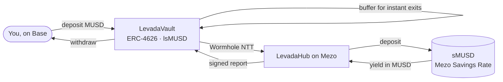

<p align="center"></p>

<p align="center"><b>Mezo's savings rate, on Base.</b></p>

Levada lets anyone holding MUSD on Base earn **Mezo's MUSD Savings Rate**, paid by the interest on Bitcoin-backed loans, without leaving Base.
- You deposit MUSD on Base and get **lsMUSD**, a savings token that grows.
- Levada carries the MUSD to Mezo over **Wormhole NTT**, the bridge MUSD itself uses, and deposits it in **sMUSD**.
- Mezo's yield then flows back into the share price. No bridge screens, no BTC for gas, and you can withdraw at any time.

About 1M MUSD sits on Base and 600k on Ethereum. Since the Aero migration paused MEZO incentives on Base (Oct 22, 2026), that MUSD earns close to nothing. Levada gives it Mezo's own yield, extends sMUSD to every MUSD holder on Base, and turns idle MUSD into sMUSD demand.

> Built for the [Mezo Buildathon on AKINDO](https://app.akindo.io/wave-hacks/OVOO0gdrVU8379D10), Track 1 (DeFi): *staking derivatives and yield vaults for MUSD, DEX integrations on other chains*.

## How it works



1. **Save on Base.** Deposit MUSD and get lsMUSD. A buffer stays on Base so small exits are instant.
2. **Cross to Mezo.** Everything above the buffer crosses on Wormhole NTT, where Wormhole's 19 guardians sign each transfer.
3. **Earn from Bitcoin borrowers.** The hub holds sMUSD, compounds its yield and reports it back over Wormhole. Each report's gain is released into the share price over 12 hours.
4. **Come home.** Larger exits are released from Mezo and paid on Base in first-in-first-out order, in minutes.

A keeper relays signed messages and pays out queued exits. **Every one of its actions is permissionless**: anyone can run it, and it only pays gas.

## Repository

| Path | What |
|---|---|
| [`contracts/`](contracts) | `LevadaVault` (Base), `LevadaHub` (Mezo), Foundry tests, audit suite, deploy scripts |
| [`keeper/`](keeper) | TypeScript keeper (viem). `npm run once` runs one pass; [`.github/workflows/keeper.yml`](.github/workflows/keeper.yml) runs it every 5 minutes |
| [`web/`](web) | Next.js app: save, withdraw, live view of where every MUSD is |
| [`brand/`](brand) | Logo, colours and tokens (the first pixel identity is in `brand/pixel-v1/`) |
| [`deployments/`](deployments) | Network addresses (Mezo, Base, Wormhole NTT, sMUSD) and our deployments |
| [`SECURITY.md`](SECURITY.md) | Trust model, guarantees, audit findings and fixes |

## Security

Levada is two immutable contracts, about 800 lines in total. The owner can pause new deposits, set the deposit cap and buffer, and set a fee of at most 20% of yield. **It cannot move funds or block withdrawals.**

An independent adversarial review found 2 high, 1 medium and 8 low issues. **All are fixed, and each has a regression test.** Details: [SECURITY.md](SECURITY.md).

```bash
cd contracts && forge test                                   # 38 tests: unit, fuzz, invariants (incl. 2,000-run liveness)
AUDIT_FORK=true forge test --match-contract AuditForkTest    # against the live NTT managers and sMUSD
```

## Run it

```bash
git clone --recursive https://github.com/Nuel-osas/levada && cd levada

# contracts
cd contracts && forge test && cd ..

# deploy (testnet): vault on Base Sepolia, hub on Mezo testnet
NETWORK=testnet OWNER=0x... TREASURY=0x... ./deploy.sh   # needs .env.keeper with KEEPER_PRIVATE_KEY

# keeper
cd keeper && npm ci && NETWORK=testnet npm run loop

# web
cd web && npm ci && npm run dev
```

## Addresses

| | Mezo | Base |
|---|---|---|
| MUSD | `0xdD46…F186` (mainnet) · `0x1189…C503` (testnet) | `0xdD46…F186` (mainnet) · `0x5609…AEA5` (Sepolia) |
| sMUSD | `0xb4D4…51CC` (mainnet) · `0x6f46…8e16` (testnet) | |
| Levada | see [`deployments/`](deployments) | see [`deployments/`](deployments) |

Full list: [`deployments/networks.json`](deployments/networks.json).

## Roadmap

- **Wave 1:** the full loop live on Mezo testnet + Base Sepolia, audited and fixed.
- **Wave 2:**
  - mainnet with a deposit cap;
  - a USDC deposit route that buys MUSD below peg on Aero;
  - an Ethereum spoke for the 600k MUSD there;
  - listing lsMUSD as Morpho collateral on Base.

Not affiliated with Mezo, Base or Wormhole.
